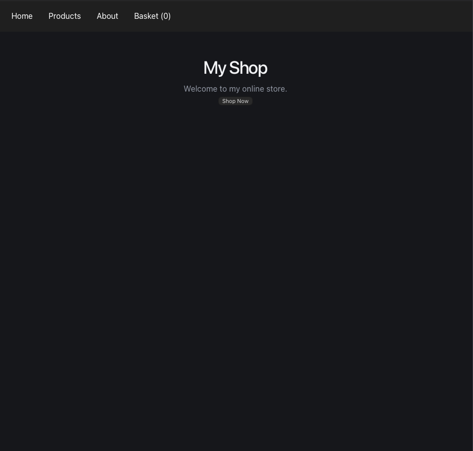
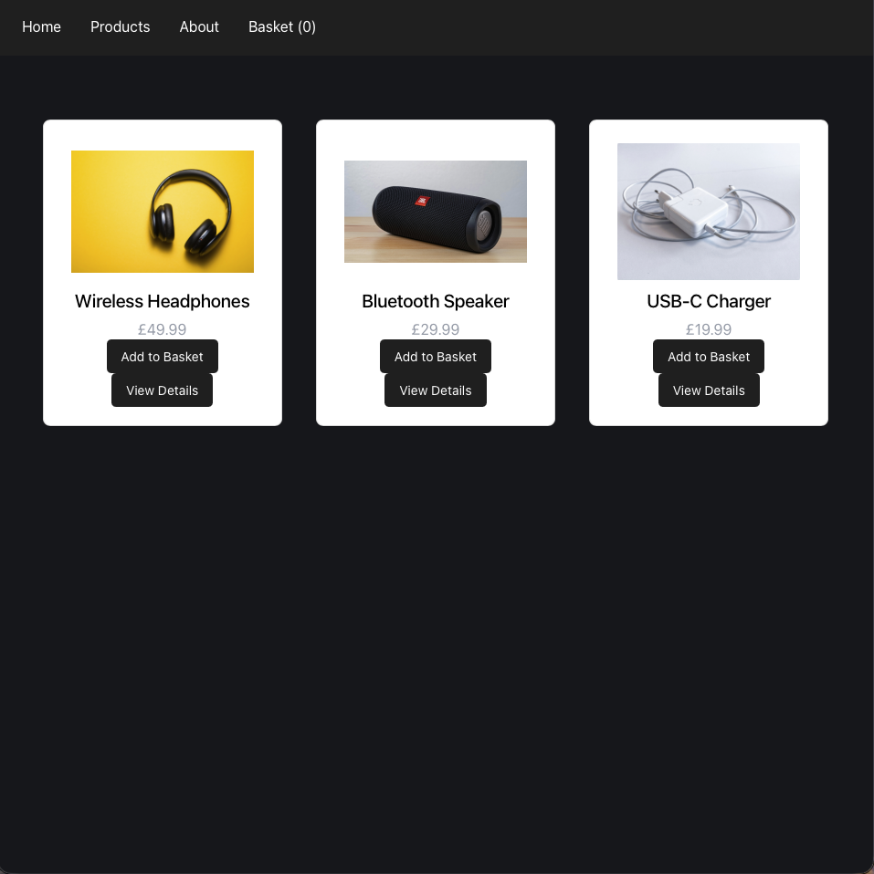
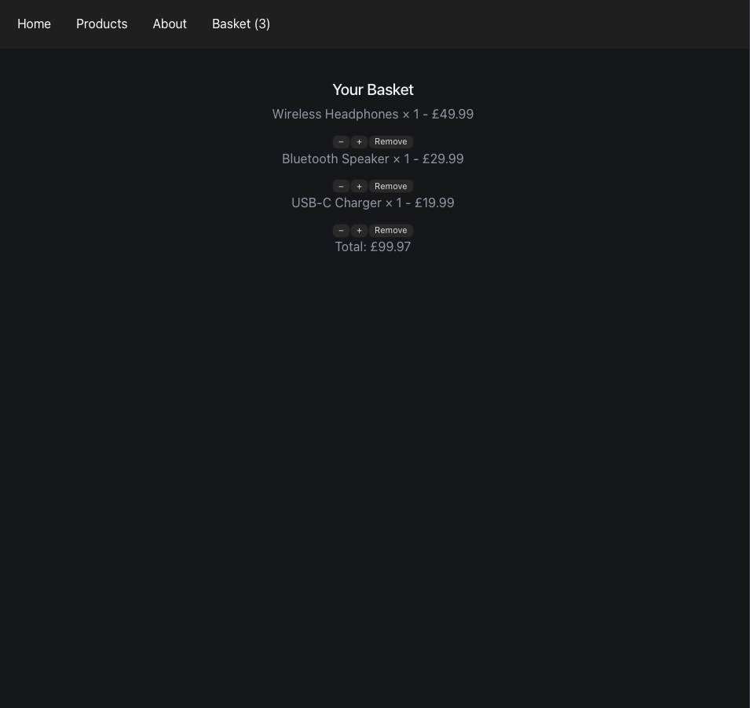
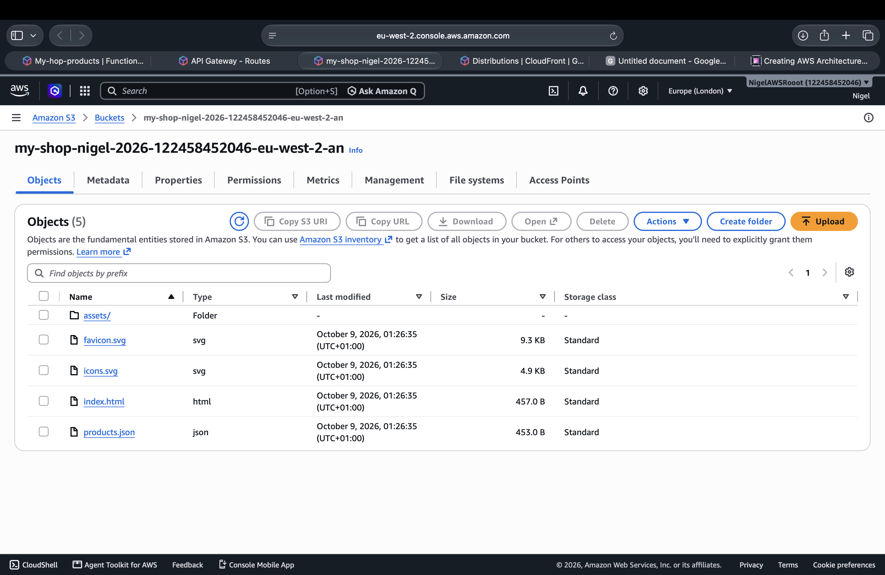
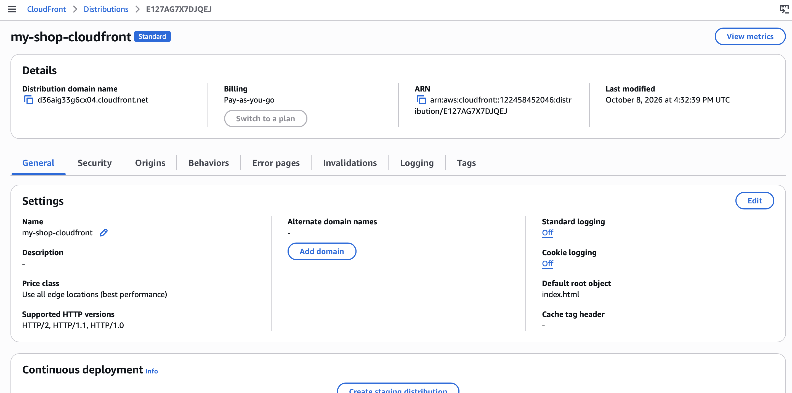
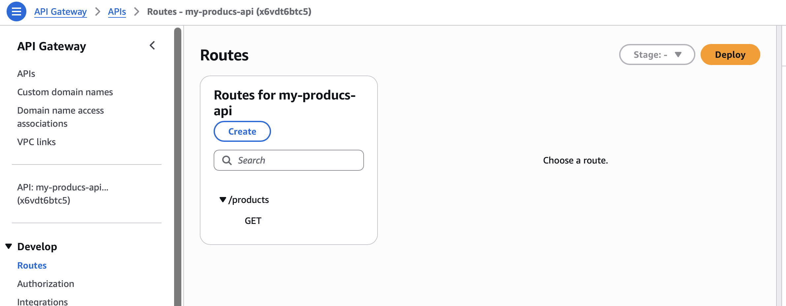
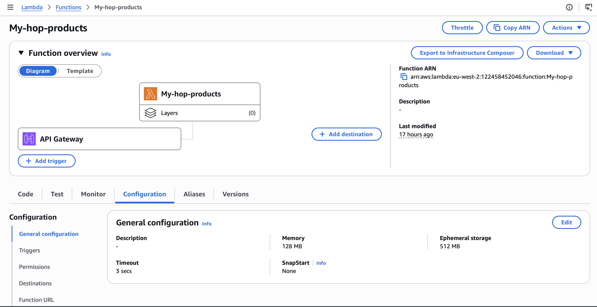
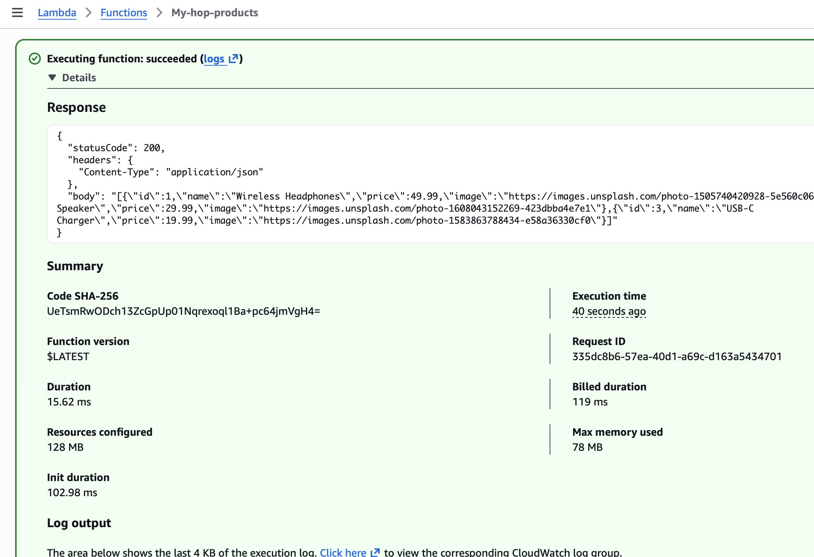

# My Shop: AWS-Hosted Serverless Web Application

## Project Overview

My Shop is a web application built locally using React and Vite, then deployed to Amazon Web Services (AWS).

The project demonstrates how to deploy a frontend application to AWS, deliver static content securely through Amazon CloudFront, and retrieve product data from Amazon DynamoDB through a serverless API built with Amazon API Gateway and AWS Lambda.

The application allows users to browse products, view product details, manage basket quantities and calculate totals. Product information is stored in DynamoDB and retrieved dynamically through the API.

The aim of this project is to develop practical cloud computing skills by building, deploying, documenting and improving a working application.

## Application Screenshots

### Shop Homepage

### Product Details

### Shopping Basket

## GitHub Repository: https://github.com/nigelviyolakuzvidza-ctrl/my-shop

### Application Features

The frontend includes the following features:
- Product catalogue: Displays product names, images and prices retrieved from the backend API.
- Product details: Individual views showing information about selected products.
- Shopping basket: Supports item quantities and calculates item totals and the overall basket value.
- Navigation: Allows users to navigate between the homepage, product catalogue, product details and shopping basket.
- AWS API integration: Retrieves product data through an Amazon API Gateway endpoint backed by AWS Lambda.
- Basket persistence: Uses browser local storage to preserve basket contents between page refreshes.
- Product catalogue: Includes wireless headphones, a Bluetooth speaker and a USB-C charger, with product information stored in Amazon DynamoDB.

### Frontend Development

The frontend was developed locally in Visual Studio Code using React and Vite.

React was used to build the application interface and manage component state, including product selection and shopping basket functionality. CSS was used to style the product catalogue, navigation, product details and basket.

Vite provided the local development server and production build tooling, allowing the application to be tested locally before deployment to AWS.

### Development Workflow

1. Developed the application locally using Visual Studio Code.
2. Used React components and JavaScript to implement the application features.
3. Used CSS to style the interface and support a consistent user experience.
4. Tested the application locally using the Vite development server.
5. Generated an optimised production build using npm run build.
6. Uploaded the generated production files from the dist/ directory to an Amazon S3 bucket.
7. Configured Amazon CloudFront to deliver the frontend securely to users.
8. Connected the frontend to an Amazon API Gateway endpoint to retrieve product data from the serverless backend.

### Frontend Technologies
- React
- JavaScript
- Vite
- HTML
- CSS
- Visual Studio Code
- Git and GitHub

## AWS Architecture

The application uses two main request flows: one for delivering the frontend and another for retrieving product data.

### 1. Frontend Delivery

The frontend is built into static production files and stored in a private Amazon S3 bucket.

Amazon CloudFront delivers the website to users over HTTPS. Origin Access Control (OAC) allows CloudFront to access the private S3 origin without requiring the bucket to be publicly accessible.

### Website delivery:
User's Browser → Amazon CloudFront → Private Amazon S3 Bucket

### 2. Product Data API

The React frontend sends an HTTP GET request to Amazon API Gateway to retrieve product data. API Gateway invokes an AWS Lambda function, which queries Amazon DynamoDB for the product information and returns the results in JSON format.

### Request flow:
React Frontend → Amazon API Gateway → AWS Lambda → Amazon DynamoDB
### Flow response 
Amazon DynamoDB → AWS Lambda → Amazon API Gateway → React Frontend

The Lambda function uses the AWS SDK for JavaScript to retrieve items from the DynamoDB Products table. It sorts the results by product ID and returns them as a JSON response.

## AWS Services
| AWS Service | Purpose |
| Amazon S3 | Stores the frontend production files. |
| Amazon CloudFront | Delivers the frontend content to users over HTTPS. |
| Origin Access Control (OAC) | Restricts access to the S3 origin so CloudFront can retrieve the website files. |
| Amazon API Gateway | Exposes the HTTP API and its GET /products route. |
| AWS Lambda | Executes serverless logic and returns product data in JSON format. |
| Amazon DynamoDB | Stores the product catalogue in the products table |
| AWS IAM | Controls Lambda's permissions to access DynamoDB and write logs to CloudWatch| 
|Amazon CloudWatch | Collects Lambda logs and metrics and monitors Lambda errors and API Gateway 5xx errors |
| Amazon SNS | Sends email notifications associated with the CloudWatch alarms |

### API Endpoint

The application retrieves product data throughan Amazon API Gateway HTTP API endpoint.

- HTTP method: GET
- Route: /******
- AWS Region: eu-west-2 (London)
- Purpose: Retrieves product records from DynamoDB through AWS Lambda.

### Cloud Skills Demonstrated
This project provides practical experience with:

- Deploying a frontend application to AWS.
- Building a production version of a React application.
- Hosting static assets in Amazon S3.
- Configuring Amazon CloudFront for content delivery.
- Using Origin Access Control to protect a private S3 origin.
- Creating an HTTP API using Amazon API Gateway.
- Integrating API Gateway with AWS Lambda.
- Retrieving product records from Amazon DynamoDB.
- Returning JSON data from a serverless backend.
- Configuring cross-origin resource sharing (CORS).
- Configuring IAM permissions for Lambda to access DynamoDB.
- Using Amazon CloudWatch logs and metrics to monitor the application.
- Creating CloudWatch alarms for Lambda errors and API Gateway 5xx errors.
- Configuring Amazon SNS email notifications for monitoring alerts.
- Using Git and GitHub for source control and project documentation.
- Testing and troubleshooting a deployed cloud application.

### Deployment

The deployment process involved building the frontend locally and hosting the resulting static files on AWS, then integrating the application with a serverless backend. 
1. Developed and tested the React application locally using Visual Studio Code and Vite.
2. Created an optimised production build using npm run build.
3. Uploaded the production files from the dist/ directory to a private Amazon S3 bucket.
4. Configured Amazon CloudFront to use the S3 bucket as its origin.
5. Configured Origin Access Control (OAC) to allow CloudFront to access the private S3 origin.
6. Created an Amazon DynamoDB table named Products to store product information.
7. Created an AWS Lambda function to retrieve product records from DynamoDB.
8. Configured the Lambda execution role with the permissions required to access DynamoDB and write logs to CloudWatch.
9. Created an Amazon API Gateway HTTP API with a GET /products route integrated with Lambda.
10. Configured CORS to allow requests from the local development environment and deployed frontend.
11. Tested the deployed website and verified that changes to DynamoDB product records appeared in the frontend.
12. Configured CloudWatch alarms to monitor Lambda errors and API Gateway 5xx errors, with Amazon SNS email notifications.
13. Documented the architecture, configuration and screenshots in the GitHub repository.

## AWS Deployment Evidence

### Amazon S3

### Amazon CloudFront

### Amazon API Gateway

### AWS Lambda Function

### Lambda Test Execution

## Future Improvements

Potential improvements include:
- Store product information in Amazon DynamoDB instead of defining it directly in Lambda. (Done)
- Automate builds and deployments using GitHub Actions.
- Introduce infrastructure as code using AWS SAM, AWS CDK, or Terraform.
- Add structured logging and monitoring with Amazon CloudWatch. (Done)
- Add automated tests and deployment validation.
- Implement a more complete checkout flow and additional backend functionality.
- Add CloudWatch logging, metrics and alarms (Done)

## Project Status

The core frontend and AWS hosting components have been configured and the application has been deployed. The serverless API is integrated with the frontend.
This project is part of my ongoing development of practical AWS and cloud architecture skills.
